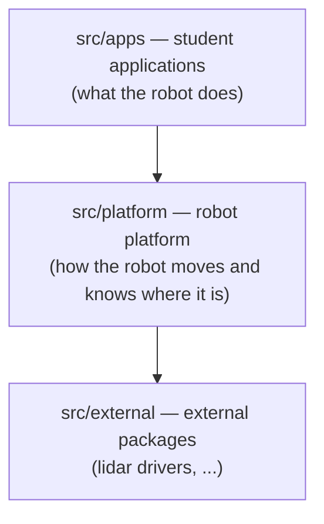
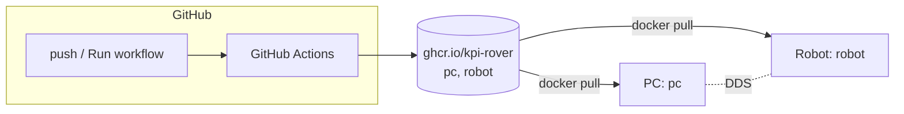
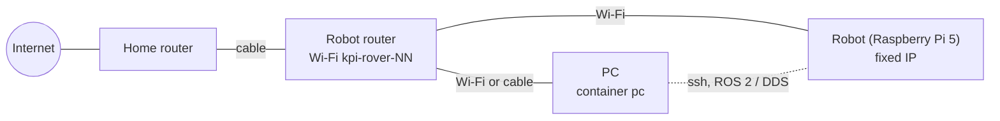
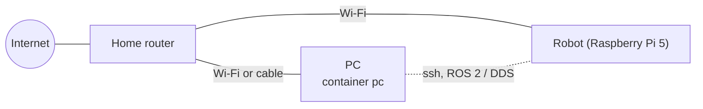
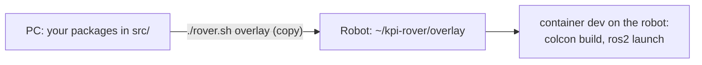

# KPI Rover ROS2 Software

ROS 2 Jazzy software of the KPI Rover: robot description, `ros2_control` hardware interface, bringup,
localization, SLAM and navigation. The same repository builds the Docker images for the PC (simulation)
and for the robot (Raspberry Pi 5).

<!-- toc -->

- [Repository layout](#repository-layout)
- [Platform and applications](#platform-and-applications)
  * [Creating an application](#creating-an-application)
- [Images and deployment](#images-and-deployment)
- [Simulation on a PC](#simulation-on-a-pc)
- [Real robot](#real-robot)
  * [Network](#network)
  * [First setup](#first-setup)
  * [Everyday work](#everyday-work)
  * [Testing your changes on the robot](#testing-your-changes-on-the-robot)
- [For maintainers](#for-maintainers)
- [Troubleshooting](#troubleshooting)

<!-- tocstop -->

## Repository layout

The repository root is the ROS 2 workspace root: packages are in `src/`, colcon creates `build/`, `install/`
and `log/` next to it.

| Path | What |
|---|---|
| `src/apps/` | application packages built on top of the platform |
| `src/platform/` | robot platform packages: `kpi_rover_*` |
| `src/external/` | external packages imported from `deps.repos` (not in git) |
| `deps.repos` | external packages that are not in apt, pinned to a commit |
| `docker/Dockerfile` | all images: `pc`, `robot` |
| `docker-compose.yaml` | PC side (service `pc`) |
| `scripts/rpi-setup/` | robot side: compose file, setup script, udev rules. Installed to `~/kpi-rover` on the robot |
| `rover.sh` | one entry point for everything below, `./rover.sh help` |

## Platform and applications

KPI Rover is a platform: a ready robot with hardware support, localization, mapping and navigation, on top of
which students build their own applications: patrolling, object search, following a person, delivery and so on.
The packages are split into layers by this idea:



**`src/platform/`** is the base that every application relies on. It is maintained by the project
maintainers and runs on every robot after boot.

| Package | What it does |
|---|---|
| `kpi_rover_description` | robot model (URDF): dimensions, wheels, sensor positions |
| `kpi_rover_hw` | `ros2_control` hardware interface: talks to the motor controller (ECU) over UART, wheel encoders, IMU |
| `kpi_rover_localization` | EKF (`robot_localization`): fuses wheel odometry and IMU |
| `kpi_rover_slam` | `slam_toolbox`: builds the map from the lidar and localizes the robot on it |
| `kpi_rover_bringup` | launch files and configs: `robot.launch.py` (real robot), `sim.launch.py` (Gazebo), Nav2, lidar, joystick |

**`src/apps/`** is for applications. An application does not drive motors or read sensors directly: it uses
the platform topics, actions and services (`/cmd_vel`, Nav2, `/scan`, `/map`, ...), so the same application
works in simulation and on the real robot.

**`src/external/`** contains third-party packages that are not released for Jazzy, imported from `deps.repos`.
They are not edited here: a change goes to the upstream repository, then the commit in `deps.repos` is updated.

### Creating an application

In the pc container (`./rover.sh pc`):
```bash
cd src/apps
ros2 pkg create my_app --build-type ament_python --dependencies rclpy geometry_msgs nav2_simple_commander
cd /workspace && colcon build --symlink-install --packages-select my_app && source install/setup.bash
```
Run the platform in simulation (`ros2 launch kpi_rover_bringup sim.launch.py`) and the application next to it
in another zellij pane. On the real robot, run it with the overlay
([Testing your changes on the robot](#testing-your-changes-on-the-robot)): `./rover.sh overlay my_app`.

## Images and deployment



| Image | Platform | Contents | Used for |
|---|---|---|---|
| `pc` | amd64 | ROS desktop-full, Gazebo, dependencies of the workspace. No sources: the repository is mounted | simulation, RViz, building |
| `robot` | arm64 | the built workspace + build tools (compilers, colcon) | runs on the robot (starts on boot); rebuilding packages on the robot (overlay) |

Image tags: `main` (current version), `<branch>` (built on request), `sha-<commit>` (fixed version).

## Simulation on a PC

Requirements: Linux with Docker ([without sudo](https://docs.docker.com/engine/install/linux-postinstall/)) and an X server.

**NVIDIA GPU.** Without [nvidia-container-toolkit](https://docs.nvidia.com/datacenter/cloud-native/container-toolkit/latest/install-guide.html)
Gazebo and RViz render on the CPU and are very slow. Install it once (Ubuntu/Debian, the NVIDIA driver must already work: `nvidia-smi`):
```bash
curl -fsSL https://nvidia.github.io/libnvidia-container/gpgkey | sudo gpg --dearmor -o /usr/share/keyrings/nvidia-container-toolkit-keyring.gpg
curl -s -L https://nvidia.github.io/libnvidia-container/stable/deb/nvidia-container-toolkit.list | sed 's#deb https://#deb [signed-by=/usr/share/keyrings/nvidia-container-toolkit-keyring.gpg] https://#g' | sudo tee /etc/apt/sources.list.d/nvidia-container-toolkit.list
sudo apt-get update && sudo apt-get install -y nvidia-container-toolkit
sudo nvidia-ctk runtime configure --runtime=docker && sudo systemctl restart docker   # stops running containers
docker run --rm --platform linux/amd64 --runtime=nvidia -e NVIDIA_VISIBLE_DEVICES=all ubuntu:24.04 nvidia-smi  # check: shows the GPU
```
`rover.sh` then uses the GPU automatically (service `pc-nvidia`). Intel/AMD GPUs need nothing extra.

Check which GPU renders: `./rover.sh pc bash -c 'glxinfo -B | grep "OpenGL renderer"'`. It must not be `llvmpipe`.

```bash
git clone https://github.com/KPI-Rover/ros_sw.git
cd ros_sw
./rover.sh deps        # import external packages (deps.repos) into src/external/
./rover.sh pc          # downloads the pc image on first start and opens it in zellij
```

Inside the container:
```bash
colcon build --symlink-install
source install/setup.bash
ros2 launch kpi_rover_bringup sim.launch.py
```

Keyboard control (second zellij pane):
```bash
ros2 run teleop_twist_keyboard teleop_twist_keyboard \
  --ros-args -r /cmd_vel:=/diff_drive_controller/cmd_vel -p stamped:=True -p frame_id:=base_link
```

`./rover.sh pc-update` downloads the newest pc image, it is needed when dependencies change in `main`.

## Real robot

### Network

The robot works over Wi-Fi. The PC must be in the same local network as the robot: `rover.sh` controls the
robot over ssh, ROS 2 topics go directly between the PC and the robot (DDS over UDP). The robot needs internet
access to download images from ghcr.io.

**Option 1 (recommended): a dedicated router for the robot.** Every robot comes with its own small travel
router (e.g. GL.iNet). The robot knows only the Wi-Fi of its router, so nothing has to be changed on the robot
when it passes to another student.



- Prepared once by the maintainers: Wi-Fi `kpi-rover-NN` with a password, a fixed IP address for the robot
  (DHCP reservation, e.g. `192.168.8.10`), client isolation off.
- At home: connect the WAN port of the robot router to the home router **by cable only**, and connect the PC to
  the Wi-Fi `kpi-rover-NN`. Do not use the repeater mode: the password of your home Wi-Fi would stay in the
  robot router, which passes to other students.
- Works anywhere, also without internet (only `setup` and `update` need it).

**Option 2: the home Wi-Fi.** The robot connects directly to the home router:



- Reserve a fixed IP address for the robot in the router (DHCP reservation).
- The router must not isolate Wi-Fi clients from each other (AP/client isolation, often enabled on guest
  networks). Some routers drop multicast, then the PC does not discover the robot automatically:
  `./rover.sh rviz` handles this, for `./rover.sh pc` see [Everyday work](#everyday-work).
- When the robot moves to another home, add the new Wi-Fi while the robot is still reachable (in the old network,
  or connected by cable to the new router):
  ```bash
  ./rover.sh wifi "<ssid>"          # asks for the password; the old networks are kept
  ./rover.sh wifi                   # list the saved networks
  ./rover.sh wifi --remove <name>   # remove one
  ```

> [!WARNING]
> Before you hand the robot over to someone else, remove your home Wi-Fi from it, otherwise your Wi-Fi password
> goes with the robot. `./rover.sh wifi` lists the saved networks (the one set in Raspberry Pi Imager is called
> `preconfigured`), remove yours with `./rover.sh wifi --remove <name>`. Do it last: the robot disconnects from
> this network immediately.

### First setup

All robots use the same user `rover` with the password `kpi-rover`. A robot passes from one student to another,
and the next student can log in without reinstalling it.

1. Flash **Raspberry Pi OS (64-bit)** with [Raspberry Pi Imager](https://www.raspberrypi.com/software/). In its settings set:
   - hostname `kpi-rover`;
   - user `rover`, password `kpi-rover`;
   - enable SSH (password authentication; you can also add your ssh public key);
   - Wi-Fi: the robot router (option 1) or your home Wi-Fi (option 2).
2. On the PC add the robot to `~/.ssh/config`. `HostName` is the robot's IP address (see the router), or
   `kpi-rover.local`:
   ```
   Host kpi-rover-rpi
       HostName 192.168.8.10
       User rover
   ```
   Optionally copy your key to avoid typing the password: `ssh-copy-id kpi-rover-rpi`.
3. Boot the robot and check the ssh access from the PC: `ssh kpi-rover-rpi`.
4. From the repository on the PC:
   ```bash
   ./rover.sh setup kpi-rover-rpi --lidar rplidar     # or --lidar coin
   ```
   The script updates the bootloader, enables the UARTs, installs the udev rules and Docker, downloads the
   robot image and starts it. It asks to reboot at the end. After the reboot the robot software starts
   automatically, on every boot.

Run `setup` again at any time, e.g. to change `--lidar` or `--wheel-radius`. The settings are in
`~/kpi-rover/.env` on the robot.

### Everyday work

```bash
./rover.sh pc          # zellij in the pc container: ros2 tools, teleop (see below)
./rover.sh status      # what runs on the robot, from which commit
./rover.sh update      # update to the newest image
./rover.sh logs
./rover.sh rviz        # RViz on the PC, connected to the robot (the workspace must be built: ./rover.sh pc colcon build)
./rover.sh ssh
```

**Working with ROS 2 from the PC.** `./rover.sh pc` opens zellij inside the pc container: a terminal with ROS 2
and the workspace, convenient for `ros2 topic`, `ros2 node`, RViz and other tools next to each other in panes.
For example, keyboard control of the robot:
```bash
ros2 run teleop_twist_keyboard teleop_twist_keyboard
```
Keys: `i` forward, `,` back, `j`/`l` turn, `k` stop, `q`/`z` faster/slower. The robot drives only while keys are
pressed. The commands go to `/cmd_vel` and the robot converts them for the controller, no remapping is needed.

If the container does not see the robot's topics (some routers drop multicast), pass the robot's address and
domain: `ROS_DOMAIN_ID=0 ROS_STATIC_PEERS=<robot IP> ./rover.sh pc`.

### Testing your changes on the robot

There are two ways: an **overlay** for a few packages (minutes, no CI) and a **branch image** for a whole branch.

**Overlay.** The robot image contains all packages built from `main`. The overlay is a small workspace on the
robot (`~/kpi-rover/overlay`) with only the packages you changed. They are built on the robot and used instead
of the same packages from the image.



1. Change the code on the PC.
2. Copy the packages to the robot and open a shell there:
   ```bash
   ./rover.sh overlay kpi_rover_hw          # several packages: ./rover.sh overlay pkg_a pkg_b
   ```
   This **stops the robot software** (the `dev` container needs the same devices) and opens zellij in the
   `dev` container on the robot.
3. Inside the container, build your packages and start the robot software with them:
   ```bash
   colcon build --symlink-install && source install/setup.bash
   ros2 launch kpi_rover_bringup robot.launch.py
   ```
   For an application in `src/apps/`: start the platform like this in one pane, open another pane (`Alt n`)
   and start your application there.
4. To change the code again: stop it with `Ctrl c`, leave zellij with `Ctrl q`, change the code on the PC and
   repeat from step 2. Only the changed files are rebuilt.
5. When you are done: leave zellij (`Ctrl q`) and start the normal robot software again, it runs from the
   image, without your changes:
   ```bash
   ./rover.sh restart
   ./rover.sh overlay --clean    # optional: delete the overlay from the robot
   ```

If you change headers or interfaces (messages, services) of a package, add the packages that depend on it to
the overlay too. A new dependency in `package.xml` is not in the image: use a branch image for that.

**Whole branch: branch image.** Push the branch, open *Actions → Build images → Run workflow*, choose the
branch. When the workflow is finished:
```bash
./rover.sh use my-branch     # back to the normal version: ./rover.sh use main
```

## For maintainers

**CI.** [.github/workflows/build-images.yml](.github/workflows/build-images.yml) builds `pc` on an x86 runner and `robot`
natively on an arm64 runner (free for public repositories). Push to `main` publishes `main` and
`sha-<commit>`, *Run workflow* publishes `<branch>`, pull requests are only built. Images of deleted branches are
removed by [cleanup-images.yml](.github/workflows/cleanup-images.yml). The packages in GHCR must be public, so that
students can pull them without a login (organization package settings).

**Dependencies.**
- A package released for Jazzy: add it to `package.xml`, rosdep installs it in all images.
- Not released, or a different version needed: add it to `deps.repos` with a tag or a commit SHA, never a branch.
- Simulation-only packages are listed in `SIM_ONLY_KEYS` in `docker/Dockerfile` and are not installed on the robot.

**Rollback.** Every image has a `sha-<commit>` tag: `./rover.sh use sha-1a2b3c4`.

**Building without CI.** `./rover.sh build` builds the robot images on the robot itself from the local sources
(Docker is controlled over ssh) and switches the robot to them (tag `local`). Back: `./rover.sh use main`.

**Diagnostics.** Ask for the output of `./rover.sh doctor`: PC and robot state, devices, settings and logs.

## Troubleshooting

| Problem | Reason / solution |
|---|---|
| Gazebo is very slow | Check `./rover.sh doctor`: `renderer` must not be `llvmpipe` (CPU rendering). Intel/AMD: the user must be in the `video` and `render` groups. NVIDIA: install nvidia-container-toolkit. |
| RViz does not show the robot | Same network? `./rover.sh rviz` uses the robot's `ROS_DOMAIN_ID` and its address as a static peer, so multicast is not required. |
| The robot software restarts in a loop | `./rover.sh logs`. `device ... not found`: check the lidar cable and `./rover.sh doctor` (devices). |
| `./rover.sh use my-branch` cannot download the image | The workflow for the branch has not finished, or failed. Check *Actions*. |
| Under-voltage (`power` is not `0x0` in `doctor`) | The power supply is too weak: random resets and USB errors. |
