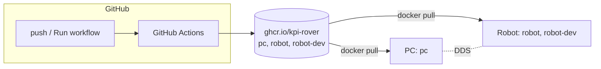

# KPI Rover ROS2 Software

ROS 2 Jazzy software of the KPI Rover: robot description, `ros2_control` hardware interface, bringup,
localization, SLAM and navigation. The same repository builds the Docker images for the PC (simulation)
and for the robot (Raspberry Pi 5).

<!-- toc -->

- [Repository layout](#repository-layout)
- [How it works](#how-it-works)
- [Simulation on a PC](#simulation-on-a-pc)
- [Real robot](#real-robot)
  * [First setup](#first-setup)
  * [Everyday work](#everyday-work)
  * [Testing your changes on the robot](#testing-your-changes-on-the-robot)
- [For maintainers](#for-maintainers)
- [Troubleshooting](#troubleshooting)

<!-- tocstop -->

## Repository layout

The repository root is the ROS 2 workspace root: packages are in `src/`, colcon creates `build/`, `install/`
and `log/` next to it.

| Path | What |
|---|---|
| `src/kpi_rover_*/` | ROS packages of the robot |
| `src/old/` | previous version, not built (`COLCON_IGNORE`) |
| `src/external/` | external packages imported from `deps.repos` (not in git) |
| `deps.repos` | external packages that are not in apt, pinned to a commit |
| `docker/Dockerfile` | all images: `pc`, `robot`, `robot-dev` |
| `docker-compose.yaml` | PC side (service `pc`) |
| `rpi/` | robot side: compose file, setup script, udev rules. Installed to `~/kpi-rover` on the robot |
| `rover.sh` | one entry point for everything below, `./rover.sh help` |

## How it works



| Image | Platform | Contents | Used for |
|---|---|---|---|
| `pc` | amd64 | ROS desktop-full, Gazebo, dependencies of the workspace. No sources: the repository is mounted | simulation, RViz, building |
| `robot` | arm64 | runtime dependencies and the built workspace | runs on the robot, starts on boot |
| `robot-dev` | arm64 | `robot` + compilers | builds an overlay of changed packages on the robot |

Image tags: `main` (current version), `<branch>` (built on request), `sha-<commit>` (fixed version).

## Simulation on a PC

Requirements: Linux with Docker ([without sudo](https://docs.docker.com/engine/install/linux-postinstall/)) and an X server.

**NVIDIA GPU.** Without [nvidia-container-toolkit](https://docs.nvidia.com/datacenter/cloud-native/container-toolkit/latest/install-guide.html)
Gazebo and RViz render on the CPU and are very slow. Install it once (Ubuntu/Debian, the NVIDIA driver must already work: `nvidia-smi`):
```bash
curl -fsSL https://nvidia.github.io/libnvidia-container/gpgkey | sudo gpg --dearmor -o /usr/share/keyrings/nvidia-container-toolkit-keyring.gpg
curl -s -L https://nvidia.github.io/libnvidia-container/stable/deb/nvidia-container-toolkit.list | sed 's#deb https://#deb [signed-by=/usr/share/keyrings/nvidia-container-toolkit-keyring.gpg] https://#g' | sudo tee /etc/apt/sources.list.d/nvidia-container-toolkit.list
sudo apt-get update && sudo apt-get install -y nvidia-container-toolkit
sudo nvidia-ctk runtime configure --runtime=docker && sudo systemctl restart docker   # stops running containers
docker run --rm --platform linux/amd64 --runtime=nvidia -e NVIDIA_VISIBLE_DEVICES=all ubuntu:24.04 nvidia-smi  # check: shows the GPU
```
`rover.sh` then uses the GPU automatically (service `pc-nvidia`). Intel/AMD GPUs need nothing extra.

Check which GPU renders: `./rover.sh pc bash -c 'glxinfo -B | grep "OpenGL renderer"'`. It must not be `llvmpipe`.

```bash
git clone https://github.com/KPI-Rover/ros_sw.git
cd ros_sw
./rover.sh deps        # import external packages (deps.repos) into src/external/
./rover.sh pc          # downloads the pc image on first start and opens it in zellij
```

Inside the container:
```bash
colcon build --symlink-install
source install/setup.bash
ros2 launch kpi_rover_bringup sim.launch.py
```

Keyboard control (second zellij pane):
```bash
ros2 run teleop_twist_keyboard teleop_twist_keyboard \
  --ros-args -r /cmd_vel:=/diff_drive_controller/cmd_vel -p stamped:=True -p frame_id:=base_link
```

`./rover.sh pc-update` downloads the newest pc image, it is needed when dependencies change in `main`.

## Real robot

The robot and the PC must be in the same network.

### First setup

1. Flash **Raspberry Pi OS (64-bit)** with [Raspberry Pi Imager](https://www.raspberrypi.com/software/). In its settings set
   the hostname (e.g. `rover`), your user, your ssh public key and your Wi-Fi.
2. Boot the robot and check the ssh access from the PC: `ssh pi@rover.local`.
3. From the repository on the PC:
   ```bash
   ./rover.sh setup pi@rover.local --lidar rplidar     # or --lidar coin
   ```
   The script updates the bootloader, enables the UARTs, installs the udev rules and Docker, downloads the
   robot image and starts it. It asks to reboot at the end. After the reboot the robot software starts
   automatically, on every boot.

Run `setup` again at any time, e.g. to change `--lidar` or `--wheel-radius`. The settings are in
`~/kpi-rover/.env` on the robot.

### Everyday work

```bash
./rover.sh status      # what runs on the robot, from which commit
./rover.sh update      # update to the newest image
./rover.sh logs
./rover.sh rviz        # RViz on the PC, connected to the robot (the workspace must be built: ./rover.sh pc colcon build)
./rover.sh ssh
```

### Testing your changes on the robot

**A few packages: overlay.** Copies the packages to the robot and builds only them on top of the robot image:
```bash
./rover.sh overlay kpi_rover_hw
```
Inside the container:
```bash
colcon build --symlink-install && source install/setup.bash
ros2 launch kpi_rover_bringup robot.launch.py
```
The robot software is stopped while you work in the overlay. Afterwards: `./rover.sh restart`.
Remove the overlay with `./rover.sh overlay --clean`.

If you change headers or interfaces of a package, add the packages that depend on it to the overlay too.
A new dependency in `package.xml` is not in the image: use a branch image for that.

**Whole branch: branch image.** Push the branch, open *Actions → Build images → Run workflow*, choose the
branch. When the workflow is finished:
```bash
./rover.sh use my-branch     # back to the normal version: ./rover.sh use main
```

## For maintainers

**CI.** [.github/workflows/build-images.yml](.github/workflows/build-images.yml) builds `pc` on an x86 runner and `robot`,
`robot-dev` natively on an arm64 runner (free for public repositories). Push to `main` publishes `main` and
`sha-<commit>`, *Run workflow* publishes `<branch>`, pull requests are only built. Images of deleted branches are
removed by [cleanup-images.yml](.github/workflows/cleanup-images.yml). New packages in GHCR are private: after the first
publish set the visibility of `pc`, `robot` and `robot-dev` to public in the organization package settings.

**Dependencies.**
- A package released for Jazzy: add it to `package.xml`, rosdep installs it in all images.
- Not released, or a different version needed: add it to `deps.repos` with a tag or a commit SHA, never a branch.
- Simulation-only packages are listed in `SIM_ONLY_KEYS` in `docker/Dockerfile` and are not installed on the robot.

**Rollback.** Every image has a `sha-<commit>` tag: `./rover.sh use sha-1a2b3c4`.

**Building without CI.** `./rover.sh build` builds the robot images on the robot itself from the local sources
(Docker is controlled over ssh) and switches the robot to them (tag `local`). Back: `./rover.sh use main`.

**Diagnostics.** Ask for the output of `./rover.sh doctor`: PC and robot state, devices, settings and logs.

## Troubleshooting

| Problem | Reason / solution |
|---|---|
| Gazebo is very slow | Check `./rover.sh doctor`: `renderer` must not be `llvmpipe` (CPU rendering). Intel/AMD: the user must be in the `video` and `render` groups. NVIDIA: install nvidia-container-toolkit. |
| RViz does not show the robot | Same network? `./rover.sh rviz` uses the robot's `ROS_DOMAIN_ID` and its address as a static peer, so multicast is not required. |
| The robot software restarts in a loop | `./rover.sh logs`. `device ... not found`: check the lidar cable and `./rover.sh doctor` (devices). |
| `./rover.sh use my-branch` cannot download the image | The workflow for the branch has not finished, or failed. Check *Actions*. |
| Under-voltage (`power` is not `0x0` in `doctor`) | The power supply is too weak: random resets and USB errors. |
